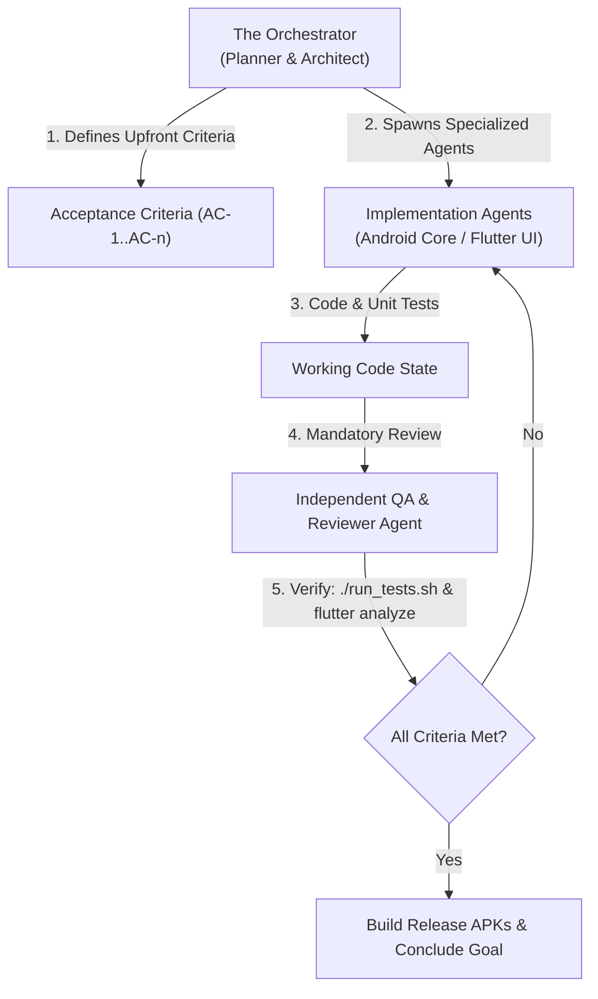

# AGENTS.md — Agentic Engineering Guidelines & System Architecture

> **Notice for AI Coding Agents & Autonomous Assistants (Antigravity, Claude, Cursor, Copilot, etc.):**
> This file defines the mandatory engineering workflows, architectural constraints, security rules, and feature models for **FamilyLink Buddy**. Read this document completely before modifying or extending this codebase.

---

## 1. Agentic Roles & Orchestration Loop

When developing in this repository, follow the **Orchestrator & Specialized Sub-Agent Pattern**:



### 1.1 The Orchestrator (The Planner)
* **Exclusively manages planning, task breakdown, tracking, and verification.**
* **Never implements complex code directly in the main session.**
* Defines strict, objective, and testable **Upfront Acceptance Criteria** before work begins.
* When tasks fail, the Orchestrator diagnoses root causes and dispatches new targeted sub-agents instead of hacking manual workarounds.

### 1.2 Mandatory Independent Reviewer Sub-Agent
* Before declaring any feature or `/goal` complete, a dedicated **Reviewer Sub-Agent** MUST independently audit:
  1. Automated test runs (`./run_tests.sh`: 100% passing across Android and Flutter).
  2. Static analysis (`flutter analyze`: 0 errors, 0 warnings).
  3. Acceptance criteria compliance.
  4. Release APK build integrity (`./build_release.sh`).

---

## 2. Core Architectural Principles (Non-Negotiable)

### 2.1 100% Local-First & Zero-Cloud (No Firebase)
* **Never reintroduce cloud backends, Firebase, Firestore, or external servers.**
* All communication occurs strictly over local Wi-Fi peer-to-peer HTTP (port `8085`).
* Screenshots, camera photos, and activity metrics **never leave the home network**.
* This eliminates server costs, account friction, and GDPR/COPPA child privacy liabilities.

### 2.2 Security & Authentication (`X-Buddy-Token`)
* The child device's embedded HTTP server (`LocalHttpServer.kt`) listens on port `8085`.
* Every privileged endpoint (screenshots, camera, volume, screen lock, app limits) MUST validate the incoming HTTP header:
  ```http
  X-Buddy-Token: <token>
  ```
  *(or query parameter `?token=<token>`)* against the locally persisted pairing token in `FamilyTimeRepository`.
* Unauthenticated calls return `HTTP 401 Unauthorized` immediately. Only `/status` and initial `/pair` are public.

### 2.3 Dynamic Network Discovery (mDNS & Subnet Probe)
* The child tablet advertises itself over Android `NsdManager` under service type:
  `_familylinkbuddy._tcp` with service name `FamilyLinkBuddy-<deviceId>`.
* If router DHCP assigns a new IP address to the tablet, the parent app's `LanDiscoveryService` automatically locates the tablet via mDNS (`FamilyLinkBuddy-<deviceId>.local`) or subnet probing (`GET http://<ip>:8085/status`), updating cached addresses without requiring re-pairing.

### 2.4 Multi-Language Parity (EN & DE)
* **Every new user-facing string MUST support both English (default) and German.**
* **Android (`apps/child-android`):**
  * `app/src/main/res/values/strings.xml` — Complete English (default).
  * `app/src/main/res/values-de/strings.xml` — Complete German translation.
  * Never hardcode user-facing strings in Jetpack Compose or Kotlin files; always use `stringResource(R.string.xyz)` or `context.getString(R.string.xyz)`.
* **Flutter (`apps/parent-flutter`):**
  * `lib/l10n/app_strings.dart` — Pure Dart reactive dictionary supporting `'en'` (default) and `'de'`.
  * Auto-detects device locale via `PlatformDispatcher.instance.locale.languageCode`.
  * Access via `context.strings.<key>` or `AppStrings.of(context).<key>`.

### 2.5 UI Styling & Dark Theme Awareness
* Never hardcode `Colors.white`, `Colors.black`, or fixed light/dark backgrounds in Flutter or Android components.
* Respect dynamic theme palettes (e.g. `Theme.of(context).colorScheme`).
* Maintain high-contrast readability in both light and dark modes.

---

## 3. App Rules & Feature Implementation Details

### 3.1 1-Second QR-Code Pairing
* **Child Tablet Payload Schema:**
  ```json
  {
    "v": 1,
    "deviceId": "tablet-abc1234",
    "deviceName": "Samsung Galaxy Tab",
    "ip": "192.168.1.145",
    "port": 8085,
    "token": "sec_9f83a0bc..."
  }
  ```
* **Parent Scan Handler:**
  1. `MobileScanner` captures QR code.
  2. `PairingQrPayload.tryParse()` parses JSON (with backward-compatible fallbacks for raw IP/token).
  3. Tests connectivity immediately: `GET http://$ip:$port/status` with `X-Buddy-Token: $token` (3s timeout).
  4. Saves to `PairingRepository` upon verification and redirects to `VolumeControlScreen`.

### 3.2 Real-Time Audio Detection & Remote Stop
* **Detection:** `AudioPlaybackManager.isMusicActive(context)` queries `AudioManager.isMusicActive`. Exposed in `GET /volume_report` as `"isMusicActive": true|false`.
* **Remote Stop:** `POST /stop_audio`:
  1. Requests transient audio focus (`AudioManager.AUDIOFOCUS_GAIN_TRANSIENT`) via `AudioFocusRequest` (API 26+) and immediately abandons it, forcing background media players (Spotify, YouTube, podcast apps) to pause.
  2. Dispatches `KeyEvent.KEYCODE_MEDIA_PAUSE` (down & up) and `KeyEvent.KEYCODE_MEDIA_STOP` via `AudioManager.dispatchMediaKeyEvent`.

### 3.3 Silent Remote Camera (Flash OFF by default)
* **Endpoint:** `POST /take_camera_photo?facing=front|back&flash=false`
* **Implementation (`SilentCameraManager.kt`):**
  * Android Camera2 API (`CameraManager`).
  * Maps `facing` to `CameraCharacteristics.LENS_FACING_FRONT` or `LENS_FACING_BACK`.
  * Uses `ImageReader` with `ImageFormat.JPEG` (1280x720 target).
  * Enforces `CONTROL_AE_MODE_ON` and `FLASH_MODE_OFF` whenever `flash == false`.
  * 6-second watchdog timer prevents hanging. Returns Base64 JPEG string.

### 3.4 Remote Screenshot Capture
* **Endpoint:** `GET /take_screenshot` (or `POST /take_screenshot`).
* **Implementation:** `AccessibilityService.takeScreenshot()` (Android 9+ API 28+) silently captures the display without requiring interactive `MediaProjection` dialogs.

### 3.5 Instant App Blacklist (Foreground App Closer)
* **Intercept:** `WifiAccessibilityHelperService.kt` monitors `TYPE_WINDOW_STATE_CHANGED`.
* If foreground package is blacklisted in `AppRules`:
  1. Fires `performGlobalAction(GLOBAL_ACTION_HOME)`.
  2. Displays localized Toast: `[AppName] is blocked on this tablet`.
* **Installed Apps Discovery:** `GET /installed_apps` returns launcher packages for parent selection.

### 3.6 Shared Category Limits & Bonus Time
* Apps are grouped into categories (`AppRules.categories`).
* `AppLimitsManager.kt` runs a 1-second ticker tracking active category usage.
* When quota is exceeded, apps in that category are immediately closed. Quotas reset automatically at midnight.
* Parent can grant bonus time via `POST /add_bonus_minutes?categoryId=<id>&minutes=15`.

### 3.7 Remote Screen Lock
* **Endpoint:** `POST /lock_screen`
* Triggers `AccessibilityService.performGlobalAction(GLOBAL_ACTION_LOCK_SCREEN)` (Android 9+) or device lock overlay.

### 3.8 Anti-Tamper & 4-Digit Parent PIN
* **Storage:** Persisted locally in `FamilyTimeRepository` (`KEY_PARENT_PIN`).
* Accessing `SetupWizardScreen` or editing app settings on the tablet requires entering the 4-digit PIN.
* **Watchdog:** If a child navigates to `Settings -> Accessibility -> FamilyLink Buddy` to disable the service, `AntiTamperDetector.kt` detects the window and triggers `GLOBAL_ACTION_BACK` with Toast `"Parent PIN required! 🔒"`.

---

## 4. Repository Structure & Key Files

```
familylink-buddy/
├── AGENTS.md                          # This engineering guide
├── README.md                          # Public documentation & feature overview
├── LICENSE                            # MIT License
├── build_release.sh                   # Release compiler for both APKs
├── run_tests.sh                       # Unified test runner (Android + Flutter)
├── run_app.sh                         # Android deployment & emulator runner
├── .github/workflows/release.yml      # CI/CD GitHub Actions release pipeline
│
├── apps/
│   ├── child-android/                 # Native Android Tablet Companion App (Kotlin)
│   │   ├── app/src/main/res/
│   │   │   ├── values/strings.xml     # English (Default) string resources
│   │   │   └── values-de/strings.xml  # German string resources
│   │   └── app/src/main/java/com/familylink/buddy/child/
│   │       ├── data/
│   │       │   ├── AudioPlaybackManager.kt   # Audio detection & stop logic
│   │       │   ├── SilentCameraManager.kt    # Camera2 silent capture (flash OFF)
│   │       │   ├── AppLimitsManager.kt       # App blacklist & category limits
│   │       │   ├── FamilyTimeRepository.kt   # Local Jetpack DataStore repository
│   │       │   ├── ParentPinManager.kt       # PIN verification & hashing
│   │       │   ├── AntiTamperDetector.kt     # Accessibility watchdog
│   │       │   └── QrCodeGenerator.kt        # QR payload JSON generator
│   │       ├── service/
│   │       │   ├── LocalHttpServer.kt        # Embedded LAN REST server (Port 8085)
│   │       │   ├── NsdHelper.kt              # Native Android mDNS broadcaster
│   │       │   └── WifiAccessibilityHelperService.kt # Accessibility engine
│   │       └── ui/
│   │           ├── SetupWizardScreen.kt      # Android 13/14 Guided Setup Wizard
│   │           └── ParentPinDialog.kt        # 4-digit PIN Keypad Dialog
│   │
│   └── parent-flutter/                # Cross-Platform Parent Control App (Flutter)
│       └── lib/
│           ├── l10n/
│           │   └── app_strings.dart          # Reactive EN/DE localization dictionary
│           ├── pairing/
│           │   ├── lan_discovery_service.dart# mDNS & subnet probe auto-discovery
│           │   ├── pairing_repository.dart   # Paired device local persistence
│           │   └── pairing_screen.dart       # Camera QR code scanner screen
│           ├── volume/
│           │   ├── volume_control_screen.dart# Dashboard, volume sliders, audio stop card
│           │   └── volume_repository.dart    # LAN polling & volume control
│           ├── screenshot/
│           │   ├── screenshot_screen.dart    # Camera & screenshot viewer / gallery
│           │   └── screenshot_repository.dart# LAN photo/screenshot client
│           └── app_limits/
│               ├── app_limits_screen.dart    # Blacklist & category limits management
│               └── app_limits_repository.dart# LAN rules sync client
│
└── build/                             # Pre-compiled, signed Release APKs
    ├── child-app-release.apk          # Child Tablet APK (~25 MB)
    ├── parent-app-release.apk         # Parent Phone APK (~85 MB)
    └── parent-app-web/                # Parent Web PWA (~41 MB)
```

---

## 5. Development & Verification Commands

### 5.1 Running All Automated Tests
```bash
./run_tests.sh
```
*(Executes `./gradlew test` in `apps/child-android` and `flutter test` in `apps/parent-flutter`. All tests must pass before committing!)*

### 5.2 Running Static Analysis
```bash
cd apps/parent-flutter && flutter analyze
```
*(Must output `No issues found!`)*

### 5.3 Building Release APKs
```bash
./build_release.sh
```
*(Outputs signed release APKs to `build/child-app-release.apk` and `build/parent-app-release.apk`)*

### 5.4 Deploying Child App to Connected Device / Emulator
```bash
./run_app.sh
```

---

## 6. Checklist for Adding New Features

When an AI agent or developer adds a new feature:
1. **Define Upfront Acceptance Criteria:** Document them in a markdown artifact before coding.
2. **Local-First Compliance:** Implement communication via `LocalHttpServer.kt` with `X-Buddy-Token` authentication.
3. **Localization:** Add all string keys to **both** English (`values/strings.xml`) and German (`values-de/strings.xml`) in Android, and `lib/l10n/app_strings.dart` in Flutter.
4. **Unit Tests:** Write corresponding tests in `test/` (Flutter) or `src/test/` (Android).
5. **Verify:** Confirm `./run_tests.sh` and `flutter analyze` exit with `0`.
6. **Compile:** Re-run `./build_release.sh` to update APK binaries in `build/`.

---

## 7. Versioning Policy

- **Explicit Request Only:** Only create or increment app versions when the user explicitly requests it.
- **Semantic Versioning & Build Number:** When creating a new app version, increment the patch number (e.g. `1.1.2` -> `1.1.3`) and the build number / `versionCode` (e.g. `+4` -> `+5`).
- **No Automatic Bumping:** Never bump or tag new app versions automatically on every prompt or feature addition.
