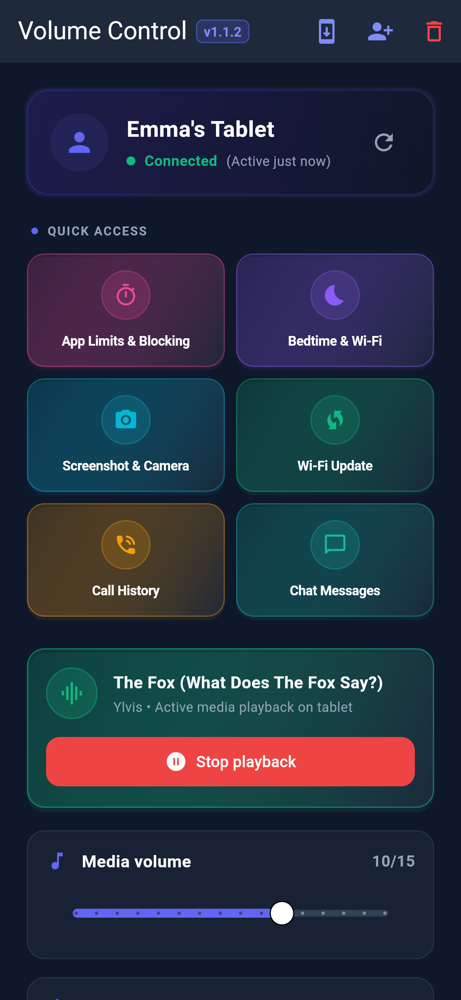
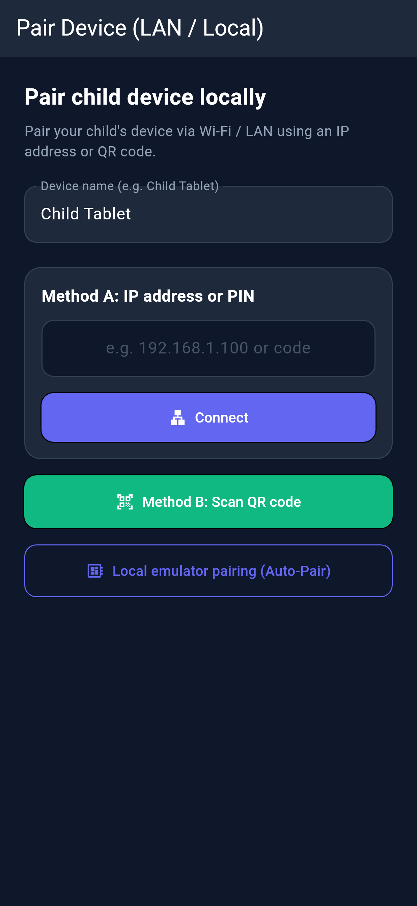
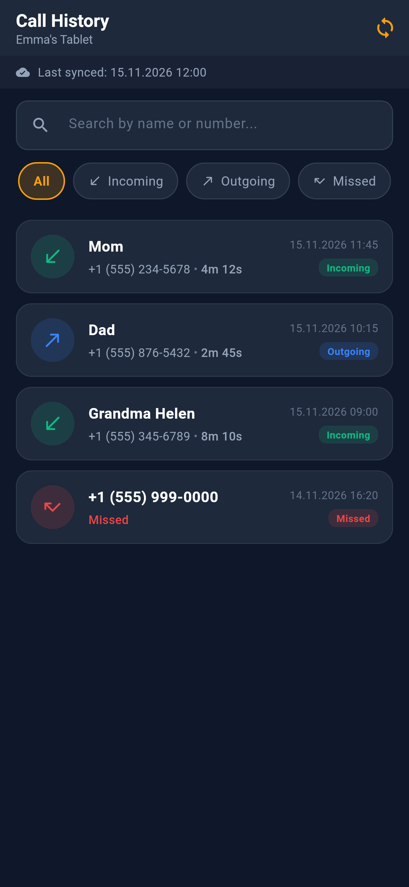
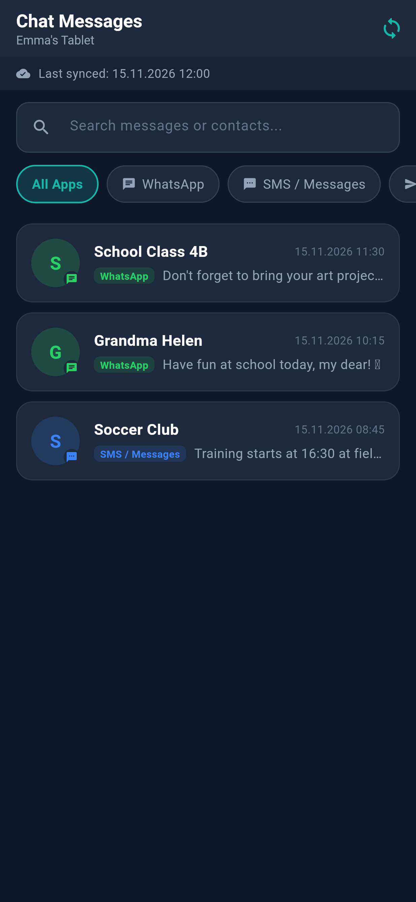
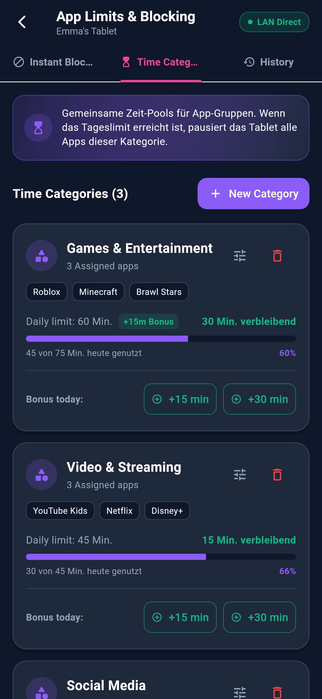
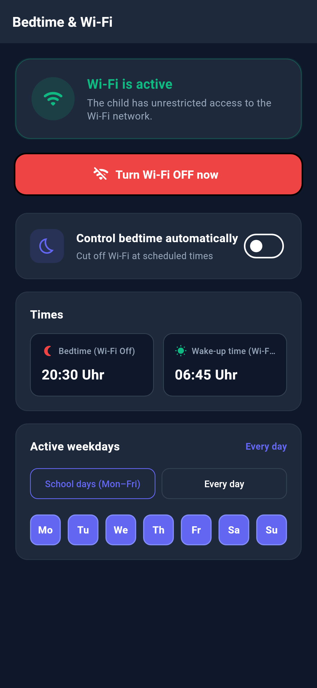
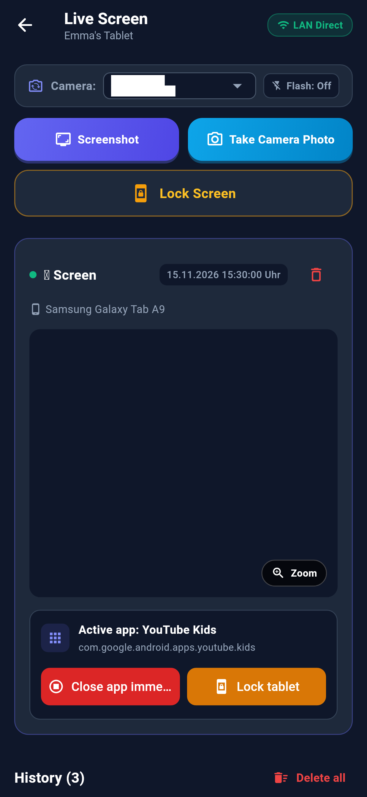

# FamilyLink Buddy 🟢

> **The 100% Local-First, Zero-Cloud Companion for Android Parental Control.**
>
> FamilyLink Buddy gives parents real-time visibility, audio controls, silent camera checks, communication monitoring, bedtime Wi-Fi automation, category app limits, and screen controls for their children's Android tablets — **completely offline on your home Wi-Fi**, without cloud accounts, Firebase, subscriptions, or external servers.

[](https://opensource.org/licenses/MIT)
[]()
[]()
[]()
[]()
[-success.svg)]()

---

## 📱 Visual Overview & Screenshots

| Parent Control Dashboard | 1-Second QR-Code Pairing |
| :---: | :---: |
|  |  |
| *Real-time Spotify track info, 1-tap remote audio stop, volume sliders, and quick action tiles.* | *Instant local Wi-Fi pairing via QR-code scan or IP/PIN entry without accounts or cloud setup.* |

| Communication & Calls Monitor | WhatsApp & SMS Message Feeds |
| :---: | :---: |
|  |  |
| *Live call logs (Incoming, Outgoing, Missed), call durations, contact avatars, and search.* | *Chat notifications log from WhatsApp and SMS with search, app filters, and thread history.* |

| App Limits & Category Quotas | Bedtime & Nightly Wi-Fi Automation |
| :---: | :---: |
|  |  |
| *Daily category quotas (Games, Streaming, Social), +15m bonus buttons, and instant app closer.* | *Automated bedtime/wake-up hours, weekday selection, and auto Wi-Fi deactivation.* |

| Silent Camera & Remote Screenshots |
| :---: |
|  |
| *Silent front/back camera photo capture (flash OFF) and live remote screen capture gallery.* |

---

## 🌟 Why FamilyLink Buddy?

Google Family Link is useful for high-level administration, but it lacks critical real-time tools for parents at home:
* *How do I stop Spotify or YouTube from playing in the kid's bedroom after bedtime?*
* *How can I see what track/artist is currently playing or if my child is still awake?*
* *How can I check who my child is calling or texting without invading their device physically?*
* *How can I grant bonus screen time (+15m / +30m) for good behavior with 1 tap?*
* *How can I check their screen activity or take a silent camera photo when they don't respond?*
* *How do I ensure the tablet Wi-Fi is automatically turned off during bedtime so they sleep?*
* *How do I control the tablet from my desktop PC, Mac, Linux laptop, or iPhone without installing an APK?*

Most third-party parental control apps upload private screenshots, camera photos, and activity logs to commercial cloud servers. **FamilyLink Buddy is 100% Local-First:**
- 🛡️ **Zero Cloud & Zero Firebase:** No accounts, no passwords, no servers. All data stays strictly inside your home Wi-Fi network.
- ⚡ **Lightning Fast (50–100ms):** Direct peer-to-peer REST communication over LAN (port 8085).
- 🌐 **Available as Android APK & Progressive Web App (PWA):** Control from your Android phone, or run directly in any desktop/mobile web browser (Chrome, Edge, Safari, Firefox) as an installable standalone PWA.
- 👨‍👩‍👧 **Multi-Kid Support:** Seamlessly switch between multiple children's tablets from a single unified dashboard.
- 🌍 **Full Multi-Language Support (EN & DE):** Automatic system language detection with in-app manual toggle between English (default) and German.
- 🔓 **F-Droid & Direct APK Ready:** No proprietary Google Play Services dependencies.

---

## ✨ Complete Feature Overview

### 🎵 1. Real-Time Audio Playback Detection, Spotify Track Info & Remote Stop
* **Live Audio & Media Metadata:** Automatically detects when audio is playing on the child tablet and displays the active **Track Title** and **Artist** in real-time (Spotify, YouTube, podcasts, audiobooks, games).
* **1-Tap Remote Stop:** Instantly pause playback from the parent app via transient audio focus request and media key events (`KEYCODE_MEDIA_PAUSE`).

### 📞 2. Communication Monitoring: Call Activity Logs
* **Real-Time Call Logging:** Logs all incoming, outgoing, and missed phone/tablet calls with exact timestamps and durations.
* **Smart Filter Chips:** Filter call logs instantly by *All*, *Incoming* (green), *Outgoing* (blue), or *Missed* (red).
* **Search & Contact Lookup:** Search records by contact name or telephone number.
* **100% Offline Cache:** Call history is transferred directly over LAN and cached locally on the parent device.

### 💬 3. Chat & Messaging Notification Feeds
* **WhatsApp & SMS Feeds:** Captures incoming messages from popular messaging apps (WhatsApp, SMS, Messages) via accessibility notification inspection.
* **Thread Grouping:** Automatically aggregates messages by sender and chat thread.
* **Unread Counters & Timestamps:** View thread timeline, unread message badges, and parent reply logs.
* **Privacy Preserving:** Messages never leave your home network; zero cloud synchronization.

### 📸 4. Silent Remote Camera (Flash OFF by default)
* **Silent Camera Snapshot:** Capture a photo on the child tablet from the parent app (Front or Back camera).
* **Guaranteed Flash OFF (`FLASH_MODE_OFF`):** Does not trigger the camera flash, preventing disturbance or sudden glare.
* **Integrated Gallery:** View camera photos with clear badges (`📷 Front Camera` vs `📱 Screenshot`), zoom in full-screen, or delete.

### 🖼️ 5. Remote Screenshots
* **Instant Screen Capture:** Request a real-time screenshot of the tablet's current screen in under 200ms via Android Accessibility.
* **Local Gallery & Batch Deletion:** Stored locally in parent app memory with option to delete individual shots or clear all history.

### 🛑 6. Instant App Blacklist & Google Assistant Blocking
* **Block Specific Apps:** Close unwanted foreground apps (e.g. TikTok, Roblox, browsers, settings) the second they are opened.
* **Google Quick Search Box & Assistant Interception:** Intercepts and blocks `com.google.android.googlequicksearchbox` and Google Assistant overlays to prevent bypassing browser restrictions.
* **Immediate Home Redirect:** Triggers `GLOBAL_ACTION_HOME` and displays a localized warning toast (`"[App] is blocked on this tablet"`).

### 📜 7. 5-Day App History & Available Apps Quick-Block
* **5-Day Launch History:** Chronological log tracking which apps were launched over the past 5 days with timestamps.
* **1-Tap Direct Block:** Instantly block any app directly from the history view.
* **Searchable Available Apps Picker:** Filter and search installed launcher apps with smart Spotify exclusion (ensuring music remains accessible unless explicitly blocked).

### ⏳ 8. Shared Category Limits & Bonus Minutes
* **Category Time Tracking:** Group apps into shared categories (e.g. *Gaming*, *Streaming*, *Social*) with shared daily minute limits.
* **Auto-Close on Limit Exceeded:** Automatically closes any app in the category once the daily quota is reached.
* **Quick Bonus Buttons:** Grant **+15 min** or **+30 min** bonus time directly from the parent app with a single tap.

### 🌙 9. Bedtime Schedule & Wi-Fi Automation
* **Automated Bedtime Hours:** Set specific bedtime and wakeup times per weekday.
* **Nightly Wi-Fi Deactivation:** Automatically disable the tablet's Wi-Fi connection during bedtime hours to ensure peaceful sleep.
* **Multi-Parent Sync & DataStore Persistence:** Bedtime settings are saved in Jetpack DataStore on the child tablet and synced across all parent phones/tablets. Settings persist reliably across app updates and tablet reboots.

### 🚀 10. In-App Updates & Accessibility Persistence
* **1-Tap Parent App Update:** In-app check for latest GitHub releases, background APK download with progress bar, and automatic installation launch.
* **P2P Child Tablet Update:** Push updated APKs from the parent app straight to the child tablet over local Wi-Fi without internet needed on the tablet.
* **Session-Based Self-Update (`PackageInstaller.Session`):** Upgrades the child companion app in-place without triggering Android 13/14 "Restricted Settings" sideload penalties.
* **Permanent Accessibility Auto-Recovery:** With `WRITE_SECURE_SETTINGS` enabled (via 1-time ADB command), the app automatically re-enables its accessibility service upon package replacement (`ACTION_MY_PACKAGE_REPLACED`), device boot, and app launch.
* **1-Tap Re-Enable Banner:** If accessibility is ever turned off, a prominent warning banner appears at the top of the child screen with a 1-tap shortcut directly to Accessibility Settings.

### 🔒 11. Instant Remote Screen Lock
* **1-Tap Lock Button:** Remotely lock the tablet screen from the parent app at any time via Android Accessibility actions.

### 👨‍👩‍👧 12. Multi-Kid Management & Fast Routing
* **Multiple Children & Tablets:** Pair and manage multiple tablets concurrently.
* **Top-Bar Child Switcher:** Instantly toggle between children via the header dropdown.
* **Direct Dashboard Routing:** Auto-routes directly to the active child's dashboard with quick "+ Add Child" pairing.

### 📲 13. Zero-Config 1-Second QR-Code Pairing
* **No IP Typing:** The child tablet displays a high-contrast QR code containing local network discovery information and a random security token.
* **Instant Verification:** The parent app scans the QR code with its camera, verifies connectivity via `GET /status`, and pairs immediately.

### 🔄 14. Dynamic mDNS & Subnet Auto-Discovery
* **DHCP Resilience:** If your home router assigns a new IP address to the tablet, the parent app automatically discovers the new IP via mDNS (`_familylinkbuddy._tcp`) or local subnet probing without requiring re-pairing.

### 🛡️ 15. Guided Setup Wizard (Android 13/14/15)
* **Bypass "Restricted Settings":** Step-by-step visual guidance helping non-technical parents navigate Android's *"Allow Restricted Settings"* prompt.
* **Direct Shortcuts:** 1-tap buttons directly open App Info, Accessibility Settings, and Battery Optimization exemptions.

### 🔐 16. Anti-Tamper & 4-Digit Parent PIN
* **Settings Lock:** Accessing the Setup Wizard or configuration on the tablet requires entering a 4-digit parent PIN.
* **Accessibility Watchdog:** Automatically intercepts and blocks attempts by the child to turn off the Accessibility service in Android Settings.

### 🌐 17. Progressive Web App (PWA) Parent App
* **Zero-Install Web App:** Run the parent control app on any device with a modern browser (Chrome, Edge, Safari, Firefox).
* **Installable Standalone App:** Install as a standalone PWA on Windows, macOS, Linux, ChromeOS, iPadOS, or iOS.
* **Self-Host Anywhere:** Serve via any static web server (Nginx, Caddy, Apache, or Python's `http.server`).

### 🌍 18. Complete Multi-Language Support (English & German)
* **Automatic System Locale Detection:** Both Child Android and Parent Flutter/Web apps automatically detect your device language.
* **English Default with German Localization:** Defaults cleanly to English for international users, with complete native German translations (`values-de/strings.xml` and `AppStringsDe`).
* **Manual In-App Language Toggle:** Switch languages on the fly via the top bar selector (`EN` / `DE`) with persisted preferences.

---

## 🏗️ Repository Architecture

```
familylink-buddy/
├── apps/
│   ├── child-android/        # Native Android Child App (Kotlin, Jetpack Compose, Camera2, Accessibility)
│   │   ├── app/src/main/res/
│   │   │   ├── values/       # English string resources (default)
│   │   │   └── values-de/    # German string resources
│   │   └── app/src/main/java/com/familylink/buddy/child/
│   │       ├── data/         # AutoRecovery, PackageInstallerHelper, UpdateManager
│   │       ├── service/      # LocalHttpServer (Port 8085), Accessibility, Bedtime, Comms
│   │       └── ui/           # SetupWizardScreen, SetupGuideDialog, ParentPinDialog
│   └── parent-flutter/       # Cross-Platform Parent App (Flutter Android & Web PWA, Material3)
│       ├── lib/
│       │   ├── l10n/         # Reactive bilingual dictionary (EN & DE)
│       │   ├── volume/       # Dashboard, volume sliders, live Spotify stop card
│       │   ├── comms/        # Calls monitoring & Chats feeds
│       │   ├── app_limits/   # Blacklist & category quotas
│       │   ├── bedtime/      # Bedtime & Wi-Fi automation
│       │   ├── screenshot/   # Remote screen & silent camera capture
│       │   ├── pairing/      # LAN discovery & QR code pairing
│       │   └── updater/      # In-App updater & P2P tablet update push
│       └── web/              # Progressive Web App manifest, index.html & service worker
├── docs/
│   └── screenshots/          # Real high-resolution PNG screenshots
├── build/                    # Pre-compiled, signed Release Artifacts
│   ├── child-app-release.apk # Child tablet APK (~25 MB)
│   ├── parent-app-release.apk# Parent Android phone APK (~89 MB)
│   └── parent-app-web/       # Parent Progressive Web App static bundle
├── .github/workflows/        # Automated GitHub Actions CI/CD release pipeline
├── build_release.sh          # Multi-target release compiler script (--all, --web-only, etc.)
├── run_tests.sh              # Unified automated test runner (Android + Flutter)
└── run_app.sh                # Local Android deployment & emulator runner
```

---

## 🚀 Installation & Setup

### 📥 1. Download Pre-Compiled Release Artifacts
Download the latest signed APKs or Web build directly from the [GitHub Releases](../../releases) page or from the `build/` directory:
* **Child Tablet:** `child-app-release.apk`
* **Parent Phone:** `parent-app-release.apk`
* **Parent Web PWA:** `build/parent-app-web/` (static web bundle)

### 📱 2. Setup on Child Tablet
1. Install `child-app-release.apk` on the child tablet.
2. Open the app — the **Setup Wizard** will guide you through 4 simple steps:
   * **Step 1:** Tap *Unlock Restricted Settings* (Android 13+: App Info → 3 dots → *Allow restricted settings*).
   * **Step 2:** Tap *Enable Accessibility* and activate **FamilyLink Buddy**.
   * **Step 3:** Tap *Disable Battery Optimization* (ensures reliable background execution).
   * **Step 4:** Set your 4-digit Parent PIN.
3. The tablet will display the **Pairing QR Code**.

#### ⚡ Permanent Accessibility Setup (Optional, Highly Recommended)
To prevent Android OEM battery cleaners or system updates from ever disabling the Accessibility service, connect the tablet to your computer once and run:

```bash
adb shell pm grant com.familylink.buddy.child android.permission.WRITE_SECURE_SETTINGS
```

*(Once granted, the app automatically recovers and re-enables its accessibility service upon device reboot, package update, and app launch without any user interaction).*

### 👨‍👩‍👧 3. Setup on Parent Device

#### Option A: Android Phone App
1. Install `parent-app-release.apk` on your phone.
2. Open the app (no registration or login required!).
3. Tap **Add Device / Pair** and scan the QR code from the child tablet.
4. **Done!** The dashboard opens immediately with live controls.

#### Option B: Progressive Web App (Desktop / Laptop / Tablet / iOS)
1. Build or serve the static web app from `build/parent-app-web`:
   ```bash
   # Quick local launch using Python:
   python3 -m http.server 8080 --directory build/parent-app-web
   ```
   *(Or deploy `build/parent-app-web/` to your home server, Nginx, Caddy, or Synology NAS).*
2. Open `http://<your-server-ip>:8080` in Chrome, Edge, Safari, or Firefox.
3. Click the **Install** icon in your browser's address bar to install FamilyLink Buddy as a standalone desktop app.
4. Enter the child tablet's IP address (or scan QR code if your laptop has a webcam) and pairing token.

---

## 🛠️ Building From Source

### Prerequisites
* **Java:** OpenJDK 17+
* **Android SDK:** API 34+
* **Flutter SDK:** 3.19+

### Compiling With `./build_release.sh`
The build script supports multiple build targets:

```bash
# Build everything (Child APK, Parent Android APK, and Parent Web PWA)
./build_release.sh --all

# Build only the Parent Progressive Web App (fastest, ~15s)
./build_release.sh --web-only

# Build only the Parent Android APK
./build_release.sh --parent-only

# Build only the Child Android APK
./build_release.sh --child-only
```

### Running Automated Test Suites
To run both Android and Flutter unit and integration tests:
```bash
./run_tests.sh
```

---

## 🔒 Security & Privacy FAQ

* **Are my child's photos, calls, or screenshots uploaded to the internet?**
  **No.** FamilyLink Buddy contains no cloud SDKs, no tracking, and no external analytics. All communication occurs strictly within your local Wi-Fi router subnet using `http://<local-ip>:8085`.
* **Is the local connection secured?**
  **Yes.** Every LAN request between the parent app and child tablet is authenticated with an `X-Buddy-Token` header exchanged securely during the initial pairing scan.
* **Can other devices on my Wi-Fi access the camera or screenshots?**
  Requests without a valid `X-Buddy-Token` are immediately rejected with `HTTP 401 Unauthorized`.
* **What happens when the child tablet IP changes?**
  The parent app automatically rediscovers the tablet via mDNS (`_familylinkbuddy._tcp`) and local subnet scanning without needing to re-pair.
* **Can the child tamper with settings or disable accessibility?**
  Access to the Setup Wizard and configuration is protected by a 4-digit Parent PIN. The anti-tamper watchdog detects attempts to disable accessibility in Android Settings and closes the window automatically.

---

## 📄 License
This project is licensed under the [MIT License](LICENSE).
